<div align="center">


# ScriptPro

**Le coffre-fort des scripts IT : rangez, exécutez et tracez vos scripts PowerShell, CMD, Batch, Bash et Python depuis une seule application.**


[Fonctionnalités](#fonctionnalités) · [Captures d'écran](#captures-décran) · [Installation](#installation) · [Développement](#développement) · [📘 Tutoriel complet](TUTORIEL.md) · [🌐 Article sur lm-code.be](https://lm-code.be/gestionnaire-de-scripts-java-javafx-sqlite/)

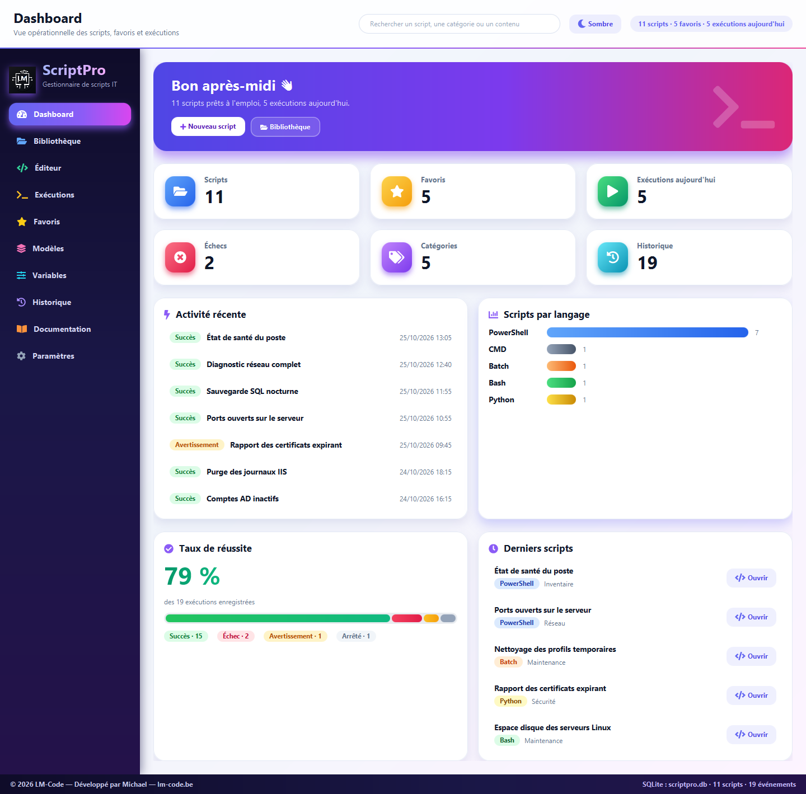

</div>

## Pourquoi ScriptPro ?

Les administrateurs systèmes et les techniciens support accumulent des dizaines de scripts éparpillés entre dossiers partagés, clés USB et notes. ScriptPro les réunit dans une bibliothèque locale, les exécute en toute sécurité et garde la trace de chaque exécution, sans serveur ni compte à créer.

## Fonctionnalités

### Bibliothèque
- Scripts classés par **catégorie** et par **tags** libres, marqués en favoris ou archivés.
- Recherche instantanée dans le nom, le contenu et les tags ; filtres par langage, catégorie, tag, favori et date.
- Import de fichiers existants (UTF-8, UTF-16 ou ANSI) et export du source ou d'un rapport PDF.

### Éditeur
- Coloration syntaxique, numéros de ligne, recherche et remplacement.
- Variables dynamiques `{{IP}}`, `{{HOSTNAME}}`, `{{DOMAINE}}`… demandées avant l'exécution.
- Raccourcis : `Ctrl+S` enregistrer, `F5` exécuter, `Maj+F5` arrêter, `Ctrl+F` rechercher.

### Interface
- Design moderne et coloré : badges de statut et de langage, indicateurs animés, transitions de page en cascade.
- Thème clair et thème sombre.

### Exécution
- Console intégrée avec **sortie en direct**, accents corrects quel que soit l'interpréteur.
- Bouton **Arrêter** : le script et tous les processus qu'il a lancés sont stoppés.
- Délai maximal configurable, dossier de travail au choix, détection des interpréteurs installés.

### Sécurité
- Analyse du script **avant chaque exécution** : suppressions récursives, formatage, registre, comptes, pare-feu, antivirus, téléchargement-exécution… La ligne et la règle concernées sont affichées.
- Motifs personnalisés (expressions régulières) ajoutables depuis les Paramètres.
- **Variables sensibles** : saisie masquée et valeur remplacée par `••••••` dans la console et l'historique.

### Traçabilité
- Historique complet : sortie, erreurs, code retour, durée, utilisateur.
- **Relance** d'une exécution en un clic, export PDF de l'historique.
- Sauvegarde et restauration de la base, avec copie de sécurité automatique.

## Captures d'écran

> Toutes les données visibles sont fictives et générées pour la démonstration.

| Bibliothèque | Éditeur |
| --- | --- |
| 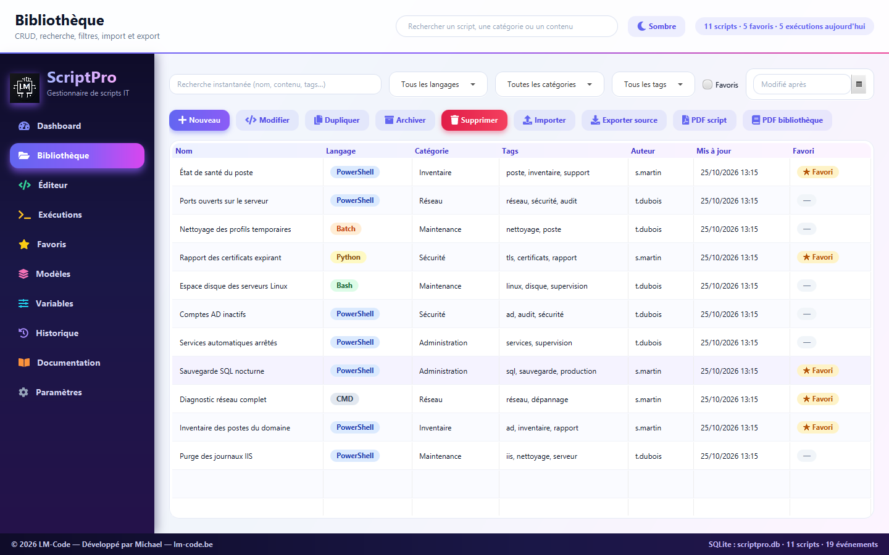 | 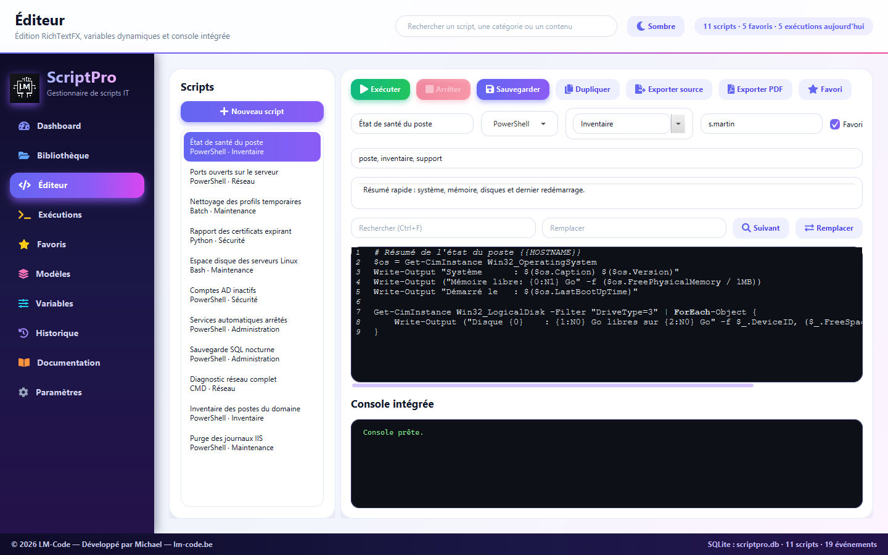 |
| **Exécutions** | **Historique** |
| 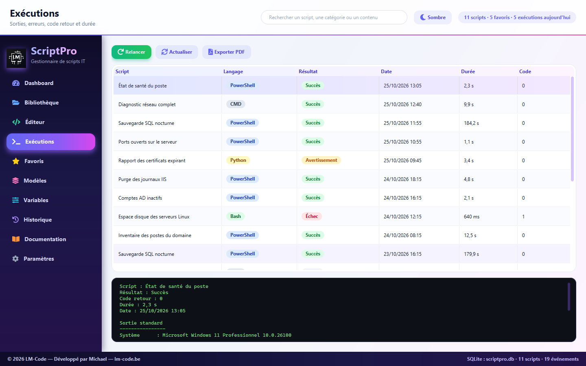 | 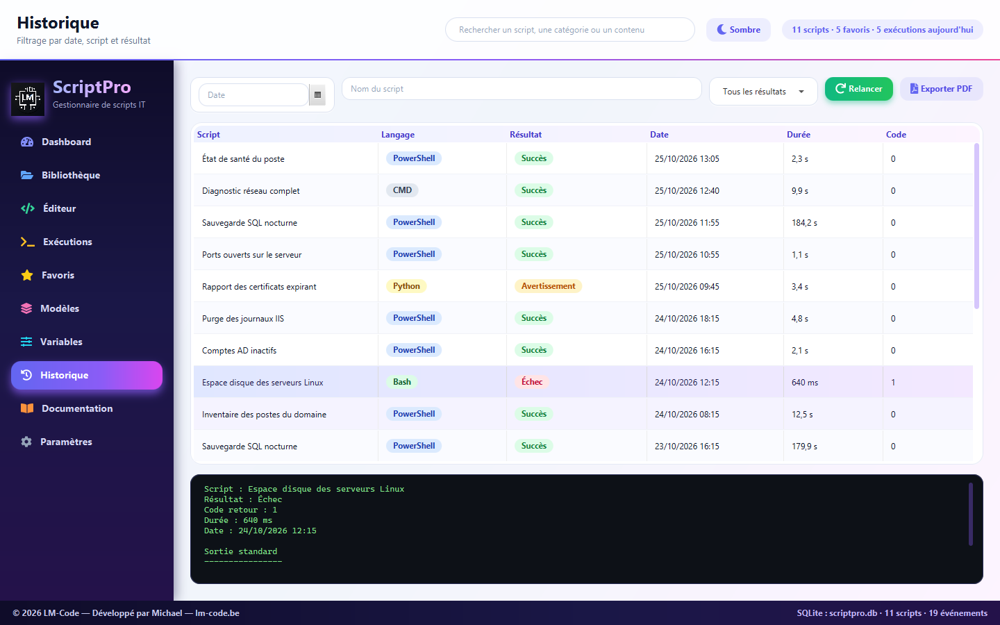 |
| **Favoris** | **Variables** |
| 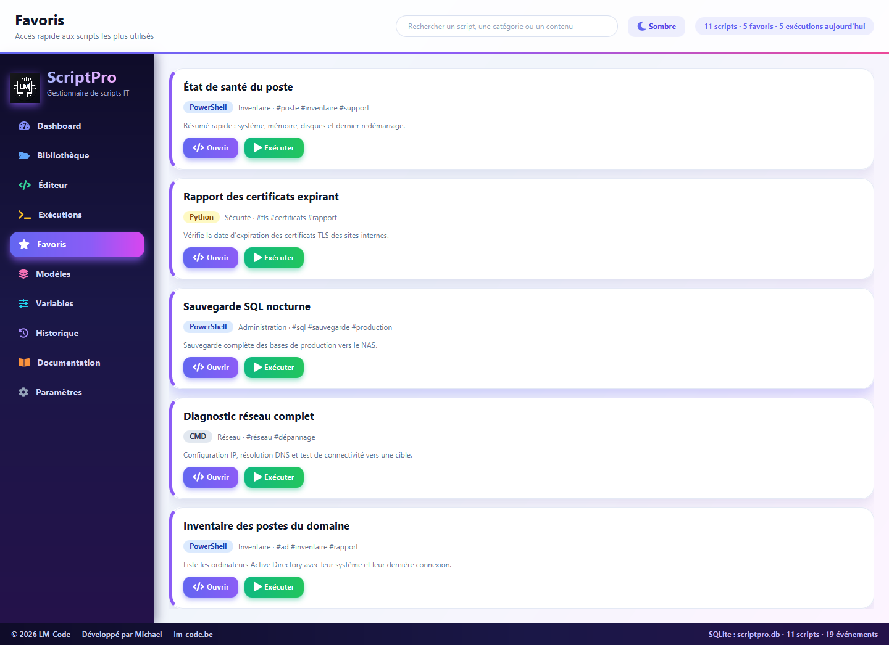 | 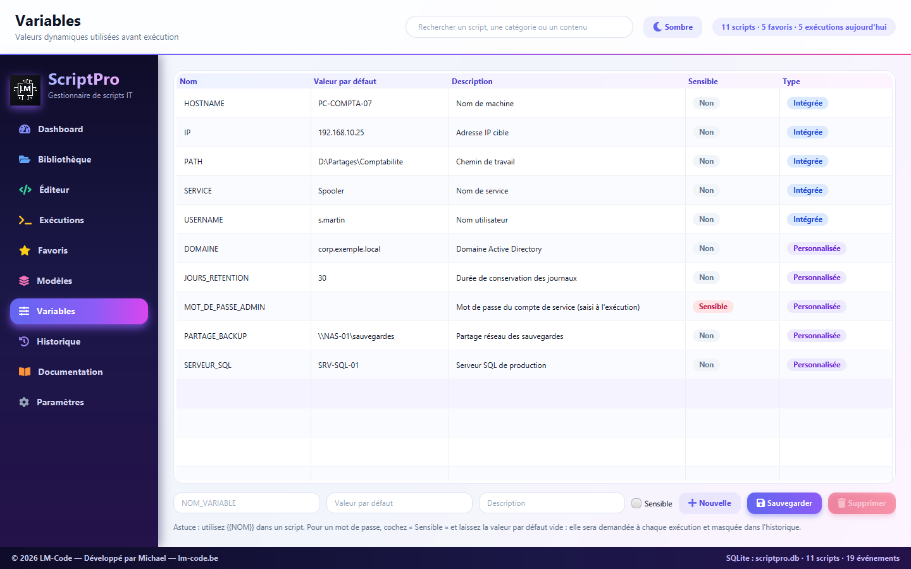 |
| **Modèles** | **Paramètres** |
| 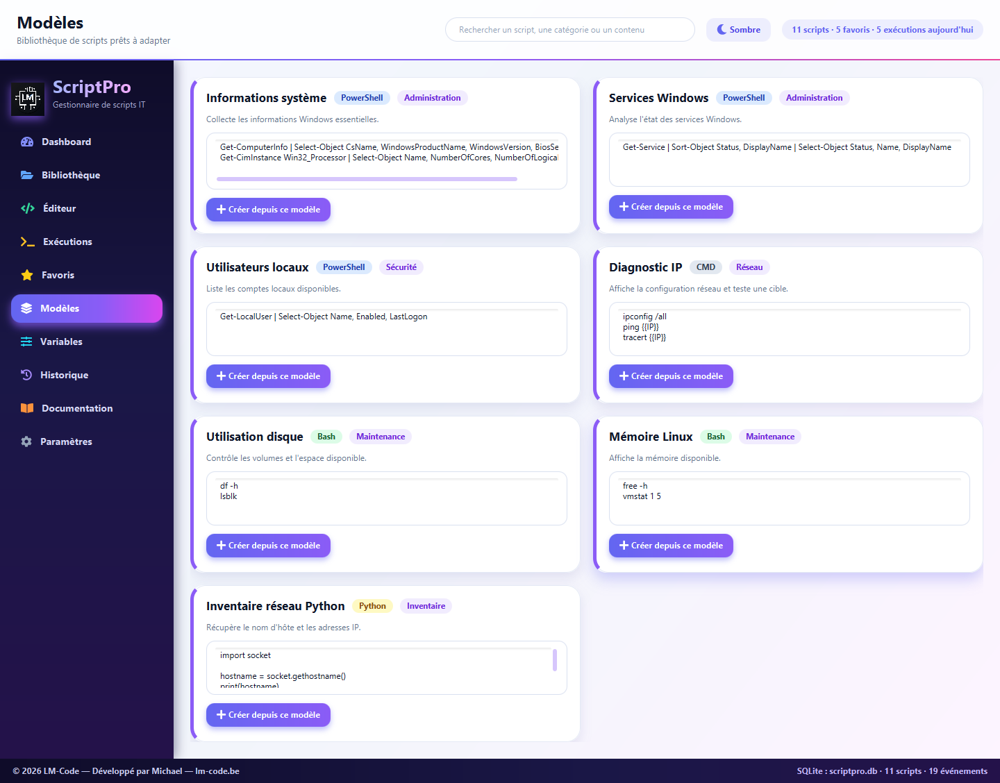 | 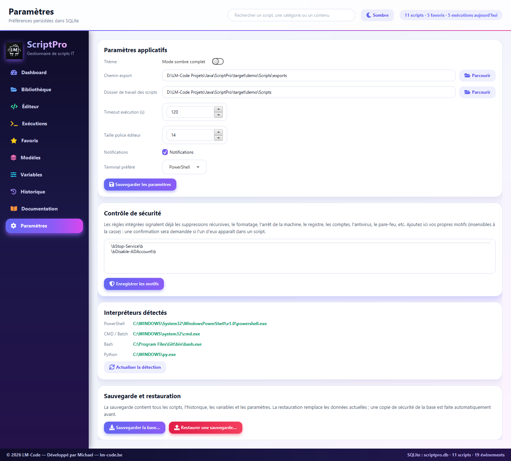 |
| **Documentation intégrée** | **Thème sombre** |
| 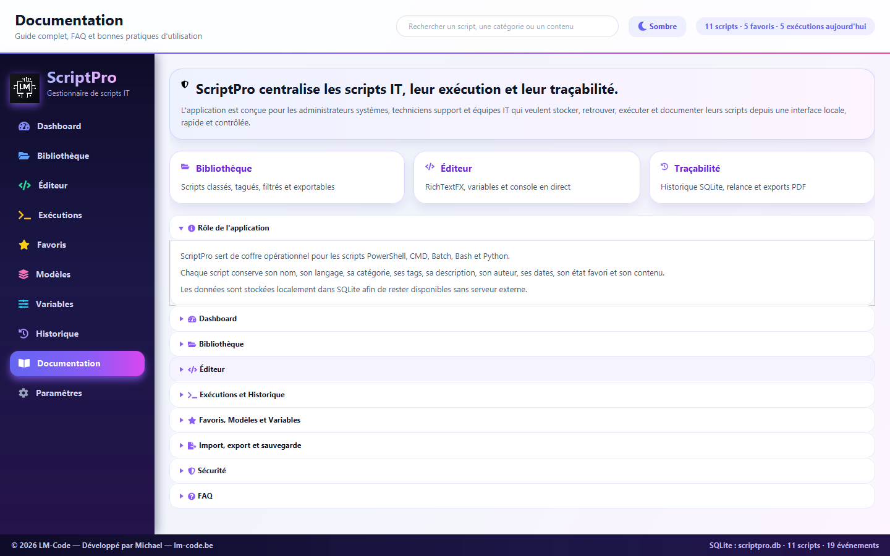 | 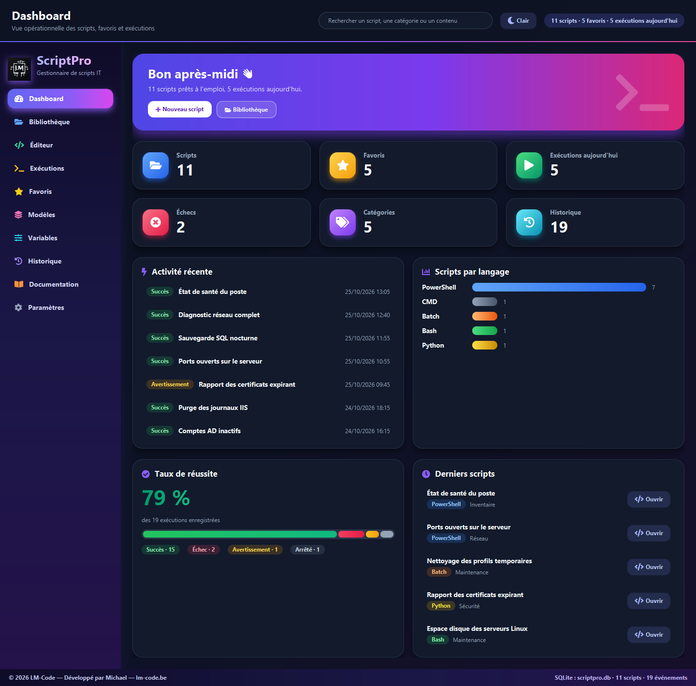 |

## Installation

### Prérequis
- Windows 10 ou 11
- [Java 21](https://adoptium.net/) ou supérieur
- [Maven](https://maven.apache.org/) 3.9 ou supérieur
- Facultatif selon vos scripts : [PowerShell 7](https://github.com/PowerShell/PowerShell), [Git Bash](https://git-scm.com/) ou WSL, [Python](https://www.python.org/)

### Lancement

```powershell
git clone <url-du-depot>
cd ScriptPro
mvn clean javafx:run
```

> Si plusieurs JDK sont installés, pointez `JAVA_HOME` vers Java 21+ avant de lancer Maven :
> `$env:JAVA_HOME = "C:\Program Files\Java\jdk-24"`

Au premier lancement, une base locale `scriptpro.db` **vide** est créée dans le dossier de l'application : aucun script ni historique, seulement les catégories, les variables usuelles (`{{IP}}`, `{{HOSTNAME}}`…) et les paramètres par défaut. Pour démarrer rapidement, l'écran **Modèles** propose des scripts prêts à adapter. Vos données restent sur votre poste ; ce fichier n'est jamais versionné.

Les bases des versions précédentes sont migrées automatiquement.

## Développement

> 📘 Tu veux comprendre comment l'application est construite, étape par étape et avec le « pourquoi » de chaque choix ? Lis le **[tutoriel complet](TUTORIEL.md)**, aussi disponible en version web sur **[lm-code.be](https://lm-code.be/gestionnaire-de-scripts-java-javafx-sqlite/)**.

### Tests

```powershell
mvn test
```

Les tests couvrent l'exécution réelle (encodage, arrêt, délai, code retour), les règles de sécurité, les migrations SQLite, la sauvegarde/restauration, les variables et l'import de fichiers. Les tests d'exécution ne tournent que sous Windows.

### Régénérer les captures d'écran

Les captures du README sont produites automatiquement à partir d'une base de démonstration fictive (`target/demo/`) ; la vraie base n'est jamais touchée.

```powershell
mvn test-compile dependency:build-classpath "-Dmdep.outputFile=target/cp.txt"
java -cp "target/classes;target/test-classes;$(Get-Content target/cp.txt)" com.scriptpro.tools.DemoScreenshots
```

Les images sont écrites dans `docs/screenshots/`.

### Structure du code

| Dossier | Rôle |
| --- | --- |
| `app` | Point d'entrée JavaFX et assemblage des services |
| `controllers` | Un écran par classe (`EditorView`, `LibraryView`…), `MainController` pour la navigation |
| `services` | Règles métier : exécution (`ScriptRunner`), sécurité, variables, sauvegarde… |
| `repositories` / `database` | Accès SQLite, schéma et migrations |
| `models` / `utils` / `ui` | Objets métier, utilitaires et composants visuels |

### Technologies
JavaFX 21 · RichTextFX · ControlsFX · Ikonli (Font Awesome 5) · SQLite (sqlite-jdbc) · JUnit 5 · Maven

---

<div align="center">

Développé par **LM-Code** — [lm-code.be](https://lm-code.be) — © 2026 — Distribué sous licence [MIT](LICENSE)

</div>
